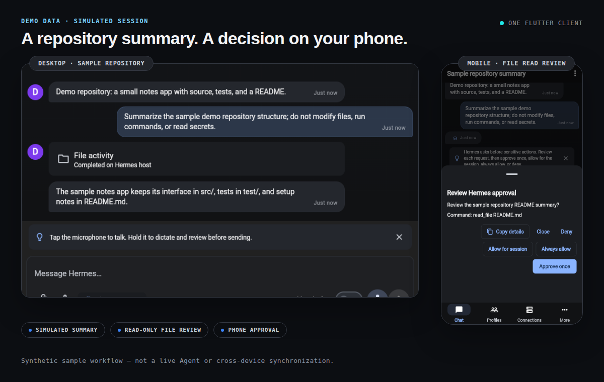

<a href="assets/branding/README.md"></a>

# Hermes Wing

**Your agent. Within reach.**

An independent Flutter client for your Hermes assistant on phone, browser and desktop.
Chat, follow tool activity and review permission requests from another screen.
**Your Agent runs the work. Wing is the client.** Guided by
[official Hermes Desktop](https://github.com/NousResearch/hermes-agent/tree/main/apps/desktop),
with parity a goal, not a guarantee. No hosted assistant or model credits are included.

**[Set up your first chat](docs/getting-started.md)** ·
[Preview the connection screen](https://trebuchetdynamics.github.io/hermes-wing/app/) ·
[Platform status](docs/getting-started.md#platform-evidence-and-limits)

> [!NOTE]
> **Early alpha · bring your own Agent.** Preview without an Agent; chat needs your own
> authenticated Agent and configured provider. Native clients require a source build;
> public signed distribution and automatic updates remain unqualified.

## A look at the workflow

Ask about a demo repository, follow file activity, then review access **if Agent asks**—synthetic data, not connected devices.

<p align="center">
  <picture>
    <source media="(max-width: 600px)" srcset="./assets/readme/showcase-mobile.png">
    
  </picture>
</p>

*DEMO DATA · SIMULATED SESSION. Not live-provider testing, cross-device synchronization,
Desktop parity proof or the planned Bot Chat experience. [View the full illustration](assets/readme/showcase.png).*

<a id="what-can-i-do-with-it"></a>
<a id="features"></a>

## What Wing does

- **Follow the conversation.** Read streaming replies and see tool activity.
- **Decide what happens next.** Review Agent permission requests or stop the selected task.
- **Keep contexts separate.** Choose Agent-owned profiles and resume their conversations.
- **Reach your Agent directly.** Use an Agent endpoint or the native SSH option.
  Browser SSH is unsupported; native full-app SSH qualification remains incomplete.

These controls have simulated Agent-response tests, not a verified complete live chat, approval and reconnect workflow.
See [workflow evidence and limits](docs/quality/live-desktop-daily-workflow.md). The [roadmap](ROADMAP.md) prioritizes
Android SSH, multi-session/profile chat, canonical Bot Chats and touch-first polish—not a list of shipped features.

<a id="new-to-hermes-start-here"></a>
<a id="what-is-hermes-agent"></a>

## What is Hermes Agent?

[Hermes Agent](https://github.com/NousResearch/hermes-agent) runs the assistant,
conversations, tools, and configuration; Wing connects directly to your own Agent.
Review its file/command permissions: a visual client does not make those actions harmless.

<a id="what-do-i-need"></a>
<a id="what-do-i-need-for-the-android-setup-guide"></a>
<a id="get-the-client"></a>
<a id="getting-started"></a>
<a id="choose-your-next-step"></a>

## Choose a path

<a id="quickstart"></a>
[Preview the UI](#preview-the-connection-screen) · [Connect your Agent](#connect-an-existing-hermes-agent) · [Build native](#build-a-native-client)
<a id="preview-without-an-agent"></a>

### Preview the connection screen

**You need:** a browser. No Agent or credential is needed just to look.
1. [Open the web alpha](https://trebuchetdynamics.github.io/hermes-wing/app/).
2. On **Welcome to Hermes Wing**, choose **Connect to Remote Hermes** to inspect the form.

**Success:** the welcome screen and connection form appear. This is an interface, not a working assistant; the hosted build can lag the source.

### Connect an existing Hermes Agent

<a id="connect-your-assistant"></a>
**Open Wing first:** use the [web alpha](https://trebuchetdynamics.github.io/hermes-wing/app/) or
[build a native client](docs/getting-started.md#build-and-open-the-client). Expect Welcome, or Chat for a saved connection.
**Before connecting, check:**

- **Agent API, not just a CLI.** Enable the authenticated HTTP API with the
  [Agent API Server guide](https://hermes-agent.nousresearch.com/docs/user-guide/features/api-server).
  Wing needs session chat and streaming support; a health check or OpenAI-compatible API alone is insufficient.
- **Trusted transport.** Native SSH verifies the host fingerprint and still needs the Agent credential.
  Remote browsers need trusted HTTPS and an explicitly allowed Wing CORS origin.
  Never expose a public port, disable trust, or treat a VPN as authentication.
  `127.0.0.1` means the device running Wing, not another computer.
- **A configured Agent profile/provider/model.** Providers may charge and process
  conversation data; self-hosting Agent does not make inference local.

Use the Agent credential in Wing, not a provider key; follow [Your first chat](#your-first-chat) and the [setup guide](docs/getting-started.md).
**Success:** a reply in your selected conversation, not a health check or saved credential. Try repository access only afterwards.

### Build a native client

**You need:** Git, Flutter 3.44.2 and target tools; follow [Build and open the client](docs/getting-started.md#build-and-open-the-client) for Android/Linux steps and recovery.
**Success:** Wing opens to its welcome screen—not Agent readiness, authentication or generation. Continue with the existing-Agent path.

<a id="connect-your-agent"></a>
<a id="pair-a-phone-or-another-computer"></a>
<a id="your-first-conversation"></a>
<a id="your-first-chat"></a>
<a id="your-first-chat-on-android"></a>

## Your first chat

1. Open Wing and choose a direct route, or **Add Hermes** to add a connection from Chat.
   Android offers **Connect via SSH**, **Connect to Remote Hermes**, then **Use this phone (Termux)**.
   Desktop/web offer **Get Started**; Linux Local only checks directory metadata, not Agent readiness.
   Use the [route guide](docs/getting-started.md#direct-agent-connection); prepare and start Agent separately.
2. Enter the Agent endpoint and its credential, then connect deliberately. Configure provider access in Agent; those are separate credentials.
3. Select your configured profile and conversation. Send:

   > Reply with one sentence introducing yourself. Do not use any tools.

**Success:** a reply appears in that conversation; wording depends on your assistant/model. No reply? Use [recovery](docs/getting-started.md#need-help).
Retry deliberately; never weaken authentication or certificates. Wing must not silently replay mutations after reconnect.
The optional [repository summary](docs/getting-started.md#optional-repository-summary) comes later, with a deliberately granted,
non-sensitive demo Project, provider costs and tool permissions understood.

<a id="project-status"></a>
<a id="platforms-and-limits"></a>
<a id="current-support"></a>
<a id="availability"></a>

## Compatibility and limits

- **Android, web and Linux are alpha paths.** Windows, macOS and iOS have limited runtime qualification.
  Use [platform evidence and limits](docs/getting-started.md#platform-evidence-and-limits) for the status of each operation.
- **Browser:** Agent access-token flow only; OAuth and SSH are unsupported. Trusted HTTPS and permitted
  CORS are required; native secure storage and host folders are unavailable.
- **Same-phone Agent:** [Termux preparation is manual](docs/getting-started.md#can-everything-run-on-the-phone-instead) and hosting is not fully qualified.
  Full-app SSH, voice, notifications and away/return recovery need named-platform qualification; voice is experimental.
- **Agent stays authoritative** for profiles, sessions, tools and assistant state.
  [Reference details](docs/quality/official-desktop-reference.md) distinguish source, simulated and live/platform evidence.

<a id="build-the-alpha-from-source"></a>

## Build from source

For a loopback-only web alpha, install Git, Flutter 3.44.2 and a browser, then run:

```bash
git clone https://github.com/TrebuchetDynamics/hermes-wing.git
cd hermes-wing
flutter pub get
flutter run -d web-server --web-hostname 127.0.0.1 --web-port 18997
```

Open **http://127.0.0.1:18997** when Flutter reports readiness; press `q` to stop.
This downloads source/dependencies and serves Wing locally—not a deployment, Agent install, provider setup or AI conversation.
For native builds, use the [Android/Linux guide](docs/getting-started.md#build-and-open-the-client).
Contributors also need Node.js 22 for browser E2E; see [contributor setup](CONTRIBUTING.md#setup).

<a id="when-a-connection-needs-attention"></a>
<a id="need-help"></a>
<a id="if-you-get-stuck"></a>

## Help and documentation

- **No connection or reply?** Start with [troubleshooting](docs/getting-started.md#need-help).
- **Agent setup:** [official documentation](https://hermes-agent.nousresearch.com/docs/) covers providers, models and tools; Wing exposes only supported operations.
- **Credentials and trust:** native secure storage varies by platform. Removing a saved connection does not revoke
  its token; rotate/revoke through Agent controls. Read the [threat model](docs/security/threat-model.md) and
  [security policy](SECURITY.md). No independent security audit is claimed.
- **Report a bug:** [open an issue](https://github.com/TrebuchetDynamics/hermes-wing/issues) with platform, steps and expected/actual behavior.
  Never include credentials, private endpoints or conversations; use the security policy for sensitive reports.
- **Explore:** [documentation](docs/README.md), [technical design](docs/spec.md), [architecture decisions](docs/adr/README.md),
  [changelog](CHANGELOG.md), [roadmap](ROADMAP.md), [work queue](TODO.md) and [contribution guide](CONTRIBUTING.md).

## License

[MIT](LICENSE). AI service access and credits are separate from the client license. Wing is independent of Nous Research;
Agent provides the runtime and Desktop the product reference.
